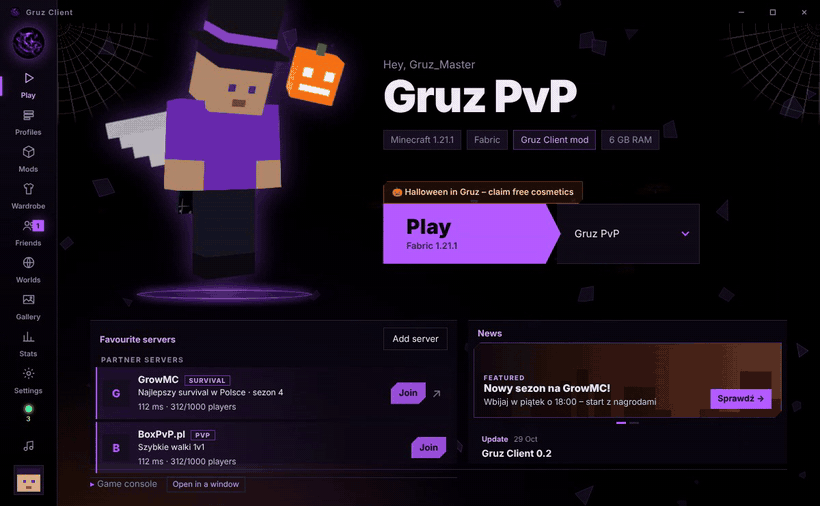
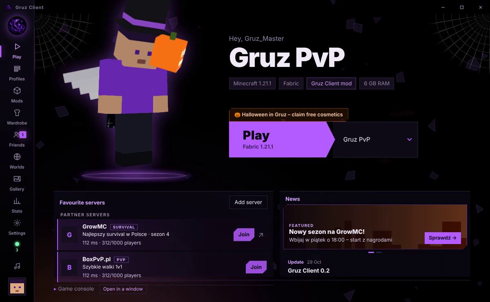
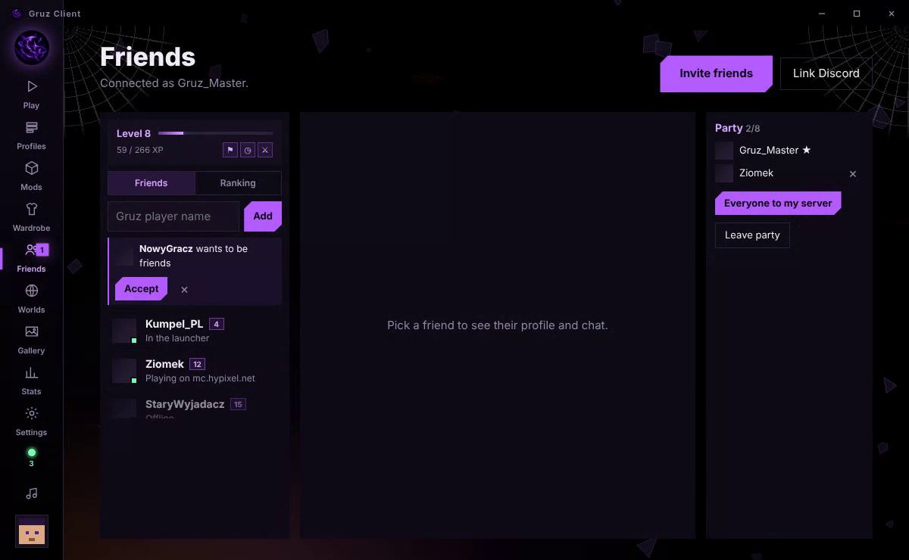
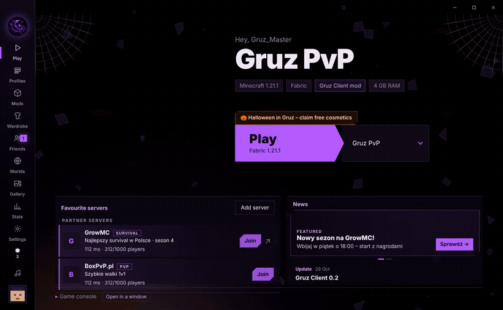

<div align="center">

# Gruz Client

**A free Minecraft client and launcher: FPS boost, cosmetics, friends & party, one-click mods.**

[](https://github.com/ilikemoneyrux/gruz-client/releases/latest)
[](https://github.com/ilikemoneyrux/gruz-client/releases)



</div>

## ✨ Features

| | |
|---|---|
| ⚡ **FPS boost** | Ready-made "Max FPS" profile (Sodium, Entity Culling, ImmediatelyFast…) in one click |
| 🧥 **Cosmetics** | Capes, wings, hats, pets, trails – visible to other Gruz players. Free Gruz cape for everyone |
| 👥 **Friends & party** | Friends list, chat, voice messages, party – join your friend's server with one click |
| 🎮 **Gruz mod** | HUD, PvP modules, menu and emotes on **1.20.4 → 26.x** (Fabric) |
| 📦 **Mods & modpacks** | Search and install Modrinth mods, resource packs and shaders right in the launcher |
| 🖼️ **Wardrobe** | 3D skin preview with your cape, change your skin without leaving the launcher |
| 🌐 **Servers** | Favorite servers with ping, partner servers, join from a copied IP |
| 📊 **Stats & levels** | Playtime, sessions, kills, levels, badges and launcher themes to unlock |
| 💥 **Crash helper** | Tells you which mod crashed the game and sends a report with one click |

<div align="center">
 
</div>

## ⬇️ Install (Windows)

1. Download **`GruzClient-Setup-x.x.x.exe`** from **[Releases](https://github.com/ilikemoneyrux/gruz-client/releases/latest)**.
2. Run it. Windows may show *"Windows protected your PC"* – click **More info → Run anyway** (the installer is not signed yet).
3. Log in with your Microsoft account, pick a version and RAM – done in 20 seconds.

<div align="center"></div>

> 🎁 **Got a creator or friend code?** Type it during the first launch and get a free cosmetic.

The launcher updates itself – you only install it once.

> ⚠️ Download Gruz Client **only** from this page or our Discord. Other copies may be fake.

## 💜 Community

- **Discord:** events, giveaways, support tickets – link your Minecraft account with `/gruz link` to get the **Gruz Member** role.
- **Invite friends:** Launcher → Friends → **Invite friends**. Every friend who joins with your code gets you closer to exclusive cosmetics.
- **Content creators & servers:** open a *Partnership* ticket on Discord – you get your own creator code, ready-made banners and a spot in the launcher.

## 🇵🇱 Po polsku

**Gruz Client** to darmowy client i launcher do Minecrafta: FPS boost, kosmetyki, znajomi i party, mody jednym kliknięciem.
Pobierz **`GruzClient-Setup-x.x.x.exe`** z [Releases](https://github.com/ilikemoneyrux/gruz-client/releases/latest), zaloguj się kontem Microsoft i graj.
Jeśli Windows pokaże ostrzeżenie: **Więcej informacji → Uruchom mimo to**. Masz kod twórcy albo znajomego? Wpisz go przy pierwszym uruchomieniu i odbierz darmową kosmetykę.

---

<details>
<summary><b>For developers</b></summary>

| Folder | What it is |
|---|---|
| `launcher/` | Electron launcher: accounts, profiles, mods, wardrobe, friends, stats |
| `mod/` | Fabric mod: menu, HUD, PvP modules, cosmetics, emotes |
| `server/` | Gruz server (Node.js): friends, chat, party, cosmetics sync, admin panel, Discord bot |

```
cd launcher && npm install && npm start      # launcher
cd server && npm install && npm start        # server (ws://localhost:8787)
```
In the launcher set **Settings → Community** to `ws://localhost:8787`. Building the installer: `npm run dist:win`.

</details>
